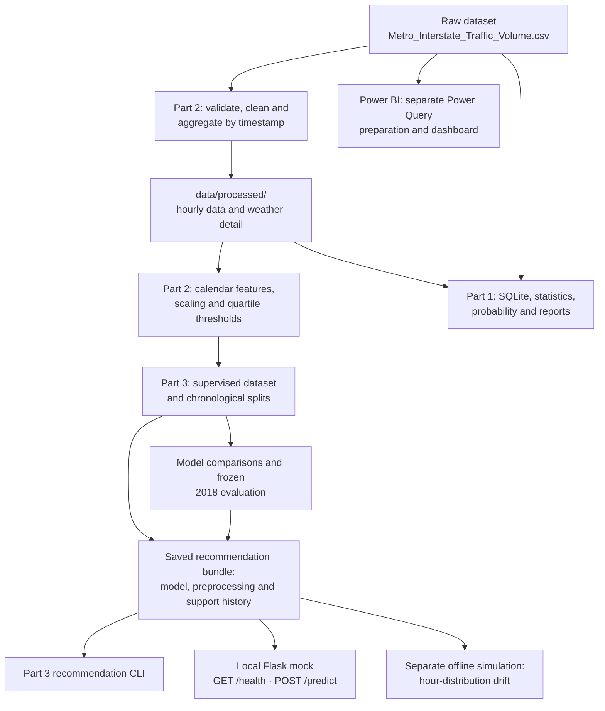

# System architecture and repository guide

This document describes the current implementation of the Smart City Traffic Intelligence capstone. It distinguishes historical analysis, model development, conditional recommendation and the separate monitoring simulation. It is an overview of a local prototype, not a production deployment design.

## Purpose and boundaries

The project uses historical westbound I-94 traffic, weather and holiday records near Minneapolis–St Paul to explore traffic patterns and compare departure windows under user-supplied weather assumptions. It estimates vehicle counts, not journey time or accident probability. There is no live traffic feed, weather forecast integration, automatic deployment or operational monitoring service.

## How the components connect

Power BI uses its own Power Query transformations of the raw source; it is not shown as consuming the Python hourly file. Its temperature measure excludes null temperatures, while the Python pipeline imputes invalid values using training-period monthly medians. Reconcile definitions before comparing figures. `monitoring.py` is a separate batch simulation using bundle support history; it is not connected to the running API or real-world outcome monitoring.

## Data and modelling contracts

1. **Source:** the root CSV contains traffic, weather and timestamps. Multiple weather records may refer to the same timestamp; counting raw rows as distinct traffic hours would overcount.
2. **Cleaning:** [`pipeline.py`](part2_python/pipeline.py) validates observations, retains weather categories, checks same-timestamp traffic consistency and writes hourly and weather-detail tables plus quality and imputation metadata to [`data/processed/`](data/processed/). Missing timestamp labels are not fabricated. The source's daylight-saving convention remains unresolved.
3. **Features:** [`features.py`](part2_python/features.py) builds calendar and cyclic-hour features, scaling and traffic quartile labels. Imputation, scaling and quartile fitting use the training reference period through 2016.
4. **Dataset and evaluation:** [`dataset.py`](part3_machine_learning/dataset.py) consumes `traffic_model_features.csv`, checks preprocessing cutoffs and constructs the supervised dataset. The recorded split is train through 2016, validation in 2017, test in 2018. The classifier target combines volume and weather as a proxy, not accident observations. Model inputs use same-hour observed weather; holdout metrics do not establish forecast-weather performance.
5. **Recommendation:** [`recommend.py`](part3_machine_learning/recommend.py) loads a self-contained saved bundle, evaluates contiguous windows under supplied conditions and checks per-hour training support. Support does not match numerical weather exactly and is not a confidence interval. The standalone Part 2 CLI offers historical `at`, `summary` and `compare` queries; it does not dispatch to the Part 3 recommendation CLI.
6. **Serving and monitoring:** [`serve.py`](part3_machine_learning/serve.py) calls the recommendation module in a local Flask mock. [`monitoring.py`](part3_machine_learning/monitoring.py) separately compares hour distributions in simulated batches. It does not match issued predictions to measured traffic; PASS does not demonstrate accuracy.

## Repository map

| Path | Responsibility and contents |
|---|---|
| [`README.md`](README.md) | Project overview, results, limitations and reviewer entry points. |
| [`Metro_Interstate_Traffic_Volume.csv`](Metro_Interstate_Traffic_Volume.csv) | Supplied raw dataset at the root; existing code depends on this path. |
| [`data/processed/`](data/processed/) | Saved cleaned data, feature datasets and preprocessing/quality metadata. |
| [`part1_data_analytics/`](part1_data_analytics/) | SQL, SQLite database, statistical analysis, Power BI, figures, tests and analysis results. |
| [`part2_python/`](part2_python/) | Cleaning and feature modules, historical-query CLI, figures, tests, logs and packaging tools. |
| [`part3_machine_learning/`](part3_machine_learning/) | Dataset, models, explainability, recommendation, local API, monitoring simulation, tests, results and reports. |
| [`output/pdf/`](output/pdf/) | Part 1 and Part 2 short reports. |
| [`output/submission/`](output/submission/) | Portable Part 2/3 archives and Part 3 acceptance record. |

Some directories deliberately contain both code and saved course evidence. Paths are used by imports, scripts, manifests, model metadata and submission archives; moving files requires a dependency audit and revalidation.

## Relationship to the original plan

The local course-workspace `Capstone_Plan_of_Attack.pdf` proposed a shared hourly grain, a course-part repository layout, an integrated CLI/recommendation path, and an MLOps demonstration. It was guidance rather than the binding course specification. The implementation keeps the three-part layout and chronological evaluation, but makes several distinct choices: retains multiple weather labels instead of a single severity label; uses a Python-produced hourly table alongside separate Power BI preparation; provides a separate Part 3 recommendation CLI rather than promoting the Part 2 CLI command; and uses a Flask mock with separate offline monitoring instead of a connected production service. These differences must be considered individually, not assumed to be errors or equivalent without evidence.

See the [Part 1 README](part1_data_analytics/README.md), [Part 2 README](part2_python/README.md) and [Part 3 README](part3_machine_learning/README.md) for component instructions. Run reproduction commands in an isolated copy: some commands replace saved outputs or models.
