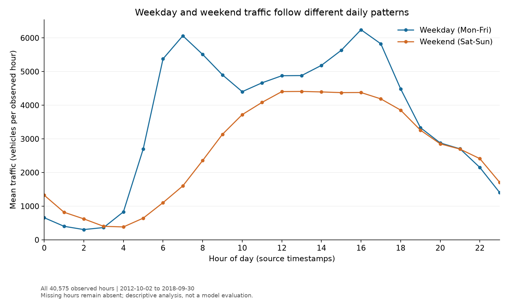

# Smart City Traffic Intelligence

**An end-to-end analytics and machine learning capstone for comparing departure windows on one I-94 corridor.** The project turns hourly traffic and weather observations into historical analysis, a reproducible Python pipeline and a conditional travel-timing prototype.

## At a glance

| Question | What the project does | Evidence |
|---|---|---|
| When is traffic busiest? | Analyses coverage, daily and hourly patterns, weather and congestion with SQLite and Power BI. | [Part 1 insights report](output/pdf/part1_data_analytics_insights_report.pdf) · [dashboard](part1_data_analytics/traffic_dashboard.pbix) |
| Can the workflow be reproduced? | Validates and cleans the data, engineers time and weather features, saves figures and offers three CLI queries. | [Part 2 report](output/pdf/part2_traffic_pipeline_report.pdf) · [pipeline instructions](part2_python/README.md) |
| Can a model compare departure windows? | Compares regression and proxy classification models, then serves a conditional recommendation through a Flask mock. | [Final report](part3_machine_learning/final_capstone_report.md) · [technical README](part3_machine_learning/README.md) |

*Observed hourly profiles across the supplied period; missing hours remain absent. See the [figure data and interpretation](part2_python/README.md#descriptive-matplotlib-figures-2026-11-24).*

## Results and interpretation

- **Data quality:** 48,204 source rows were aggregated to 40,575 distinct timestamp labels while preserving multiple weather categories. Nine complete months are absent; unequal annual coverage limits trend comparisons. The source timestamp's daylight-saving convention is not resolved. [Cleaning details](part2_python/README.md) · [coverage](data/processed/coverage_by_year.csv)
- **Traffic and weather:** the observed temperature–traffic correlation is weak (Pearson r = 0.1392); this is descriptive, not evidence of a causal weather effect. [Part 1 results](part1_data_analytics/results/temperature_correlation.csv)
- **Model evaluation:** the regression forest selected on 2017 validation achieved 241.54 vehicles/hour MAE and 0.9600 R² on 6,533 observed 2018 timestamp labels. The model uses **same-hour observed weather**; these figures do not measure end-to-end forecasts using weather predictions. [Frozen protocol](part3_machine_learning/results/final_evaluation_plan.json) · [holdout metrics](part3_machine_learning/results/final_2018/metrics.json)
- **Conditional recommendation:** in a saved weekday scenario with clear weather and 20°C, the supported 08:00–19:00 search ranked 10:00–12:00 first, at about 4,425 vehicles/hour. This is an assumed fixed-weather comparison, not a live forecast, travel-time estimate or safety guarantee. [Scenario and assumptions](part3_machine_learning/results/recommendation/weekday_clear.json)

## Evaluation and responsible use

The pipeline fits imputation, scaling and traffic quartile thresholds on training data through 2016. Models were compared on 2017, then selected forests were evaluated on the available 2018 period. The observed-weather inputs and single sensor constrain generalisation; no later data or forecast-weather evaluation is claimed.

No accident dataset was supplied. Classification predicts a **constructed congestion-and-weather proxy**, not actual accident probability. Weather is also part of the proxy definition, which contributes to high scores. The [bias and fairness report](part3_machine_learning/bias_and_fairness_report.md) examines coverage and subgroup errors.

The recommendation ranks supported windows under user-supplied conditions; rare scenarios may return insufficient support. The monitoring simulation detects changes in the distribution of input hours; a PASS does not establish predictive accuracy. [Recommendation examples](part3_machine_learning/results/recommendation/recommendation_manifest.json) · [monitoring evidence](part3_machine_learning/results/monitoring/simulation.json)

## Review the deliverables

| Course part | Entry point | Portable package or evidence |
|---|---|---|
| 1 · Data analytics | [SQL, statistics, probability and dashboard notes](part1_data_analytics/README.md) | [Power BI file](part1_data_analytics/traffic_dashboard.pbix) · [two-page report](output/pdf/part1_data_analytics_insights_report.pdf) |
| 2 · Python pipeline | [Pipeline, CLI and logging instructions](part2_python/README.md) | [Part 2 ZIP](output/submission/capstone_part2.zip) · [acceptance record](part2_python/validation/submission_acceptance.json) |
| 3 · Machine learning | [Final report](part3_machine_learning/final_capstone_report.md) · [technical README](part3_machine_learning/README.md) | [Part 3 ZIP](output/submission/capstone_part3.zip) · [package acceptance](output/submission/capstone_part3_acceptance.json) |

The Part 2 report is a dated development snapshot: its statement that the final modelling split was undecided describes the earlier Part 2 stage. For the subsequently frozen split and evaluation, see the Part 3 final report and protocol linked above.

The Part 3 ZIP includes models, scripts and portable MLflow exports; the original host's tracking database is not included. The acceptance record states which checks were run and whether a fresh environment installation was tested.

## Run and reproduce

Use Python 3.11 and the pinned dependencies in [Part 2 requirements](part2_python/requirements.txt) and [Part 3 requirements](part3_machine_learning/requirements.txt). Commands and inputs are documented in each part's README. To review the saved artifacts, no training is required.

**Use an isolated copy for full reproduction.** Pipeline, training, verification and packaging commands can overwrite processed data, logs, saved models or result files. Retraining also creates new MLflow runs. See the [Part 1](part1_data_analytics/README.md), [Part 2](part2_python/README.md) and [Part 3](part3_machine_learning/README.md) instructions before running them. The Part 3 ZIP contains a separate reviewer guide and saved evidence.

Project folders: `part1_data_analytics/` contains SQL, statistics and Power BI; `part2_python/` contains the pipeline, CLI and figures; `part3_machine_learning/` contains modelling, explainability, recommendation, API and monitoring; `data/processed/` holds derived data.

Saved input hashes describe the bytes used in each recorded run. Git line-ending normalisation can change a CSV's byte hash across checkouts even when its data values are unchanged.

## Dataset attribution

Hogue, J. (2019). *Metro Interstate Traffic Volume* [Dataset]. UCI Machine Learning Repository. [https://doi.org/10.24432/C5X60B](https://doi.org/10.24432/C5X60B). The [UCI dataset page](https://archive.ics.uci.edu/dataset/492/metro%2Binterstate%2Btraffic%2Bvolume) identifies the dataset licence as [Creative Commons Attribution 4.0 International](https://creativecommons.org/licenses/by/4.0/).
