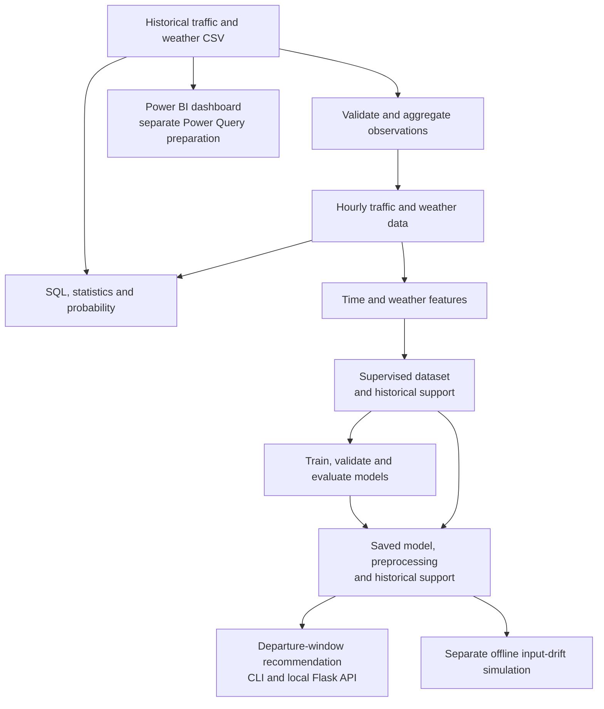

# Smart City Traffic Intelligence

An analytics and machine learning capstone that uses historical traffic and weather records to explore traffic patterns and compare departure windows on one westbound I-94 corridor near Minneapolis–St Paul.

**Question:** Given a date, an allowed time range and assumed weather, which departure window is expected to have lower traffic volume?

The answer is a conditional estimate of vehicles per hour. It is not a live traffic forecast, travel-time estimate or safety guarantee.

## Project workflow

The Python pipeline produces the data used for statistical analysis and modelling. Power BI prepares the source separately in Power Query. The monitoring simulation uses saved reference data; it is not connected to a live API or observed traffic outcomes. See [architecture and data contracts](ARCHITECTURE.md) for the detailed connections.

## Data and analysis

- **Source:** 48,204 records from October 2012 to September 2018, including traffic volume, weather and holiday fields. The dataset covers one sensor location.
- **Hourly grain:** Multiple weather records can share one traffic timestamp. Cleaning produces 40,575 distinct observed timestamp labels and retains multiple weather categories without counting the traffic volume repeatedly.
- **Coverage:** Nine complete months are missing. Missing timestamps are not treated as zero traffic, and the source timestamp's daylight-saving convention is unresolved.
- **Exploration:** SQLite, descriptive statistics, probability analysis and a Power BI dashboard examine traffic patterns, weather and coverage. The observed temperature–traffic correlation is weak (Pearson r = 0.1392); correlation does not establish a causal effect.

See the [Part 1 insights report](output/pdf/part1_data_analytics_insights_report.pdf), [analysis details](part1_data_analytics/README.md) and [Power BI file](part1_data_analytics/traffic_dashboard.pbix). The PBIX file requires Power BI Desktop.

## Models and evaluation

To respect the order of time, preprocessing parameters are fitted on the training period through 2016. The project compares models on 2017 validation data and evaluates the selected models on observed 2018 records.

| Regression result | 2018 holdout |
|---|---:|
| Observed timestamp labels | 6,533 |
| Random forest mean absolute error | 241.54 vehicles/hour |
| Random forest R² | 0.9600 |

The MAE is an average over this test set, not a bound on individual errors. The model uses **same-hour observed weather**. These metrics do not measure an end-to-end forecast using weather information available in advance. See the [evaluation plan](part3_machine_learning/results/final_evaluation_plan.json), [saved metrics](part3_machine_learning/results/final_2018/metrics.json) and [final report](part3_machine_learning/final_capstone_report.md).

The classification task uses a constructed traffic-and-weather proxy because no accident dataset was supplied. It does not predict accident probability; weather also contributes to the proxy definition. See the [bias and fairness report](part3_machine_learning/bias_and_fairness_report.md).

## Example: comparing departure windows

For a saved weekday scenario, the user requests a two-hour window between 08:00 and 19:00, with clear weather, 20°C and the same assumed weather throughout the interval. The prototype ranks **10:00–12:00** first, at approximately **4,425 vehicles/hour**.

The system checks historical training support for each candidate hour. When support is insufficient, it can return no recommendation. Support counts describe matching historical observations; they are not confidence intervals or guarantees, and do not require an exact match on numerical weather values. [View the saved scenario](part3_machine_learning/results/recommendation/weekday_clear.json).

## Repository guide

| Location | Contents |
|---|---|
| [`Metro_Interstate_Traffic_Volume.csv`](Metro_Interstate_Traffic_Volume.csv) | Original input dataset. |
| [`data/processed/`](data/processed/) | Cleaned hourly data, features and processing metadata. |
| [`part1_data_analytics/`](part1_data_analytics/) | SQL, statistics, Power BI, results and tests. |
| [`part2_python/`](part2_python/) | Cleaning and feature pipeline, historical-query CLI, visualisations and tests. |
| [`part3_machine_learning/`](part3_machine_learning/) | Model evaluation, saved models, recommendation, local API, monitoring simulation and tests. |
| [`output/pdf/`](output/pdf/) | Part 1 and Part 2 reports. |
| [`output/submission/`](output/submission/) | Portable Part 2 and Part 3 packages. |
| [`ARCHITECTURE.md`](ARCHITECTURE.md) | Component connections, data contracts and implementation boundaries. |

## Review and reproduce

To review the results, start with the [final report](part3_machine_learning/final_capstone_report.md) and [saved recommendation](part3_machine_learning/results/recommendation/weekday_clear.json); neither requires training a model. For detailed setup and commands, see the [Part 2 README](part2_python/README.md) and [Part 3 README](part3_machine_learning/README.md).

The deliverable archives are [Part 2](output/submission/capstone_part2.zip) and [Part 3](output/submission/capstone_part3.zip). The Part 2 PDF describes an earlier stage when the final modelling split had not yet been decided; the final split is recorded in the Part 3 report and evaluation plan.

Use Python 3.11 and the pinned dependencies in the component requirements files. **Use an isolated copy for full reproduction:** pipeline, training, validation and packaging commands can overwrite generated data, logs, models or results. Retraining is not necessary to inspect the saved evidence. The original host's MLflow tracking database is not included; portable run exports are provided.

## Dataset attribution

Hogue, J. (2019). *Metro Interstate Traffic Volume* [Dataset]. UCI Machine Learning Repository. [https://doi.org/10.24432/C5X60B](https://doi.org/10.24432/C5X60B). The [dataset page](https://archive.ics.uci.edu/dataset/492/metro%2Binterstate%2Btraffic%2Bvolume) lists its licence as [CC BY 4.0](https://creativecommons.org/licenses/by/4.0/).
